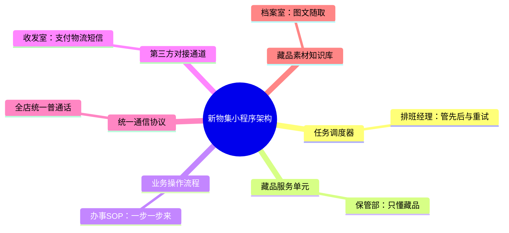
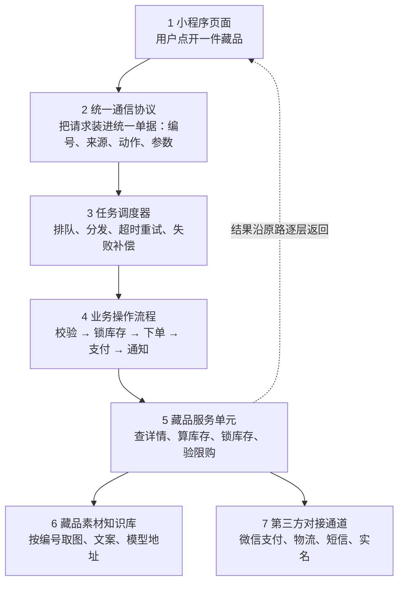

# 新物集小程序架构：六个术语的大白话版

> **背景**：新物集是游卡旗下桌游文创预售平台（2019 年底上线微信小程序）。把新物集想成一家卖桌游和文创的店，这六个术语就是店里六个岗位的分工。看懂谁干什么、谁跟谁说话，就懂了整个系统怎么跑起来。
>
> **阅读提示**：文中思维导图和数据流图使用 Mermaid 绘制。在 VS Code 中打开本文件后，按 `Ctrl+Shift+V` 打开预览；若图形显示为代码块，请先安装插件 **Markdown Preview Mermaid Support**（微软官方出品），再重新预览即可。

---

## 一、六个岗位，各管一摊

### 1. 任务调度器

**类比：拿着对讲机的值班经理**

他**不亲自搬货**，只负责安排：谁先干、谁后干、卡住了怎么办。用户点开一件限定桌游，背后有查详情、锁库存、下单、支付回调、发货通知一大堆事，不可能一拥而上，得排成队一件件派下去。

干到一半超时了，他喊"再来一遍"（重试）；三次都不成就记一笔"失败待补偿"，回头补上，而不是让用户干等着。预售开抢那种瞬间流量，全靠他把洪峰削平，否则系统直接被压垮。

### 2. 藏品服务单元

**类比：保管部里只管藏品的一个小组**

它的职责边界窄得刻意：这件藏品是什么、还有没有货、这个用户能不能买、买走一件库存就减一。**它不懂支付、不懂物流、不懂页面长什么样**，别人问它什么它只答那几件事。

边界窄的好处很实在：规则要改（比如"每款限购 1 件"）只动它一处，不会牵一发动全身；流量大了只给它加机器，别的模块不用跟着扩容。

### 3. 业务操作流程

**类比：贴在墙上的办事流程图（SOP）**

"用户下单"听起来是一步，其实是好几步：校验购买资格 → 锁住库存 → 生成订单 → 调起支付 → 等支付回调 → 写发货单 → 发通知。流程就是把这串顺序**写死**：先做什么、后做什么、哪一步失败该退回哪一步。

比如支付超时了，必须把刚才锁住的库存放回去，否则这件藏品就"卡死"在没人能买的状态。有了流程，程序员不用每次临时想顺序，出问题也能一眼看出卡在第几步。

### 4. 第三方对接通道

**类比：公司的对外收发室**

收钱找微信支付、发货找快递公司、通知找短信平台、认证找实名接口。所有"跟外面打交道"的事，都从这一个窗口进出，**内部模块不直接伸手去接**。

好处是换人不换房：哪天换物流商，只改收发室，业务代码一行不动；外面接口升级了，也只在这里做适配，不会波及全系统。对外的事都关在一扇门里，风险就被关住了。

### 5. 统一通信协议

**类比：全店说同一种普通话，填同一种单据**

不管谁跟谁说话，都按同一套格式来：谁发的、要干什么、参数是什么、单号多少、怎么算成功。调度器派活、单元回报、通道回调，用的都是这张单子。

这样谁都能听懂谁，不用为每两个部门单独配一个翻译；出问题的时候，拿单号一搜，整条链路发生了什么就全串起来了。协议统一，是上面所有模块能拼在一起的前提。

### 6. 藏品素材知识库

**类比：档案室兼素材仓库**

藏品的高清图、细节图、模型图、宣传文案、年代背景，统一编号、统一存放、统一规格。页面要用时按编号直接取，不用每次现找、现裁、现压缩。

对桌游文创这种"看图下单"的品类，图好不好、加载快不快，直接决定买不买。素材集中管，换一张图只改一处，全站同步生效。

---

## 二、思维导图

六个岗位全部围绕"一件藏品从被看到到被买走"这件事分工。

---

## 三、运行过程：一次"点开限定款并下单"

用户手指点下去的那一秒，系统里发生的是下面这条流水线，编号就是调用顺序：

**一句话串起来**：用户点一下 → 协议把话说明白 → 调度器安排谁先干 → 流程规定按什么顺序干 → 藏品服务单元办正事 → 素材库供图、第三方通道收钱发货 → 结果原路回去变成一页界面。

---

## 四、这条流水线上，被调用的组件清单

按调用顺序排列，第 7 项之后就开始往回走了：

| 序 | 组件 | 在这次运行里干了什么 |
|:--:|------|----------------------|
| 1 | 小程序页面 | 用户点开藏品，前端发起一次请求（入口） |
| 2 | 统一通信协议 | 把请求打包成标准单据：谁发的、要干什么、单号多少、怎样算成功 |
| 3 | 任务调度器 | 接单、排队、分发给下游；超时重试，反复失败转失败补偿 |
| 4 | 业务操作流程 | 编排整条链路，维护订单状态，失败时知道该退回哪一步 |
| 5 | 藏品服务单元 | 查藏品详情、算实时库存、锁库存、校验限购规则 |
| 6 | 藏品素材知识库 | 按藏品编号返回图片、文案、模型等素材地址（旁路，通常走 CDN） |
| 7 | 第三方对接通道 | 调起微信支付下单、查询物流、发短信通知、做实名校验（出网） |
| 8 | 沿原路返回 | 结果逐层回传，页面渲染出"已下单，待支付" |

---

## 五、数据流分析：七个启发问题

课程给出的数据流分析框架，逐条套在新物集这个预售系统上回答。

### Q1 系统作为信息处理器主要完成什么功能？最重要的输入和输出数据是什么？

一句话：**把"藏品信息 + 用户的购买意图"加工成"一份已履约的订单"**。输入有三路——用户的操作请求（浏览、下单、付款）、商家上架的藏品与素材、库存与限购配置；输出也有三路——页面展示数据、订单与支付结果、发货单与通知消息。其中最重要的输入是**购买请求**，最重要的输出是**订单及其状态变化**，全系统都围着它转。

### Q2 系统作为一个整体，和外界环境存在什么关系？

它不是孤岛，而是一边接住环境、一边伸进环境：向**用户**（微信生态里）收请求、还页面；向**第三方商家/厂商**收藏品与素材、还销量与结算数据；向**微信支付、物流公司、短信平台、实名认证服务**发出指令、收回凭证与回执。资金流、物流、信息流三条线都穿过系统边界，而系统本身还要遵守微信小程序平台的规则约束。

### Q3 系统功能复杂，是否能够分解为几个相对独立又有联系的子系统或子功能？

能，而且这正是六个术语的来历：**任务调度器、藏品服务单元、业务操作流程、第三方对接通道、统一通信协议、藏品素材知识库**。"独立"体现在职责边界窄、可单独修改和扩容；"联系"靠两根线——统一通信协议让大家说同一种话，业务操作流程把大家按顺序串起来。

### Q4 分解后的子功能是否仍然很复杂，还可以划分为更细更具体的子功能吗？

可以继续往下切一层：

| 模块 | 可再细分 |
|------|----------|
| 藏品服务单元 | 信息查询、库存计算、限购校验、库存锁定与回滚 |
| 任务调度器 | 队列管理、重试策略、失败补偿 |
| 藏品素材知识库 | 存储、编号索引、规格处理与 CDN 分发 |
| 第三方对接通道 | 支付适配器、物流适配器、短信适配器（各自独立的"插头"） |
| 业务操作流程 | 下单子流程、支付子流程、发货子流程、售后子流程 |

切到这一层，每个零件都小到一个程序员能独立负责。

### Q5 每个功能或子功能的输入数据和输出数据是什么？

| 模块 | 输入 | 输出 |
|------|------|------|
| 统一通信协议 | 原始请求、外部回调 | 带单号的标准单据 |
| 任务调度器 | 标准单据 | 派工单、执行结果、补偿任务 |
| 业务操作流程 | 派工单 | 订单状态变更指令 |
| 藏品服务单元 | 查询 / 锁定指令 | 藏品详情、库存结果、锁定凭证 |
| 藏品素材知识库 | 藏品编号 | 图片、文案、模型的 CDN 地址 |
| 第三方对接通道 | 支付 / 发货 / 通知指令 | 支付凭证、运单号、短信回执 |

### Q6 系统中需要长期保存的数据有哪些？这些数据如何创建、修改和使用？

六类数据值得长期留在数据库里：

| 数据 | 创建者 | 修改者 | 使用者 |
|------|--------|--------|--------|
| 藏品主档与素材 | 商家 | 运营 | 页面展示 |
| 库存与限购配置 | 商家 | 商家 / 系统 | 下单时原子扣减 |
| 订单与支付流水 | 业务流程 | 状态机 | 售后、对账 |
| 用户与收货地址 | 用户 | 用户 | 下单发货 |
| 物流单与通知记录 | 第三方通道 | 物流回调 | 追溯查询 |
| 日志与审计 | 调度器、流程 | 只追加 | 排障、对账 |

共同原则："谁创建谁负责、状态变更留痕"。

### Q7 在一个业务流程中，数据来源到最后去处是否完整？

完整，而且是一条能追回来的闭环：用户请求 → 协议单据 → 调度派工 → 流程推进 → 订单落库 → 支付回调 → 发货单 → 物流单号 → 通知用户。每一步都带同一个单号，正向能追溯"货到哪了"，反向能回滚"失败退库存"。

唯一的天生缺口是**外部回调可能迟到或丢失**（比如支付结果没通知到），所以系统用定时对账与补偿任务兜底——这也是调度器存在的另一个理由。

---

## 附：这套结构的关系

六个词并不平级：**统一通信协议是"大家怎么说"，任务调度器是"谁什么时候干"，业务操作流程是"按什么顺序干"，剩下三个（藏品服务单元、素材知识库、第三方通道）是"具体谁来干"**。缺了协议，调度器和单元互相听不懂；缺了调度器，流量高峰一到请求就会一拥而上压垮系统；缺了流程，支付失败后库存会一直卡在锁住的状态，谁都买不到。

---

> 术语取自新物集（游卡旗下桌游文创预售平台）小程序系统的模块划分；文中"值班经理""收发室"等为便于理解的类比，不代表官方命名。场景以"限定款桌游预售 + 下单支付"为例，其他业务（众筹进度、社区内容、售后）走的是同一套骨架。
