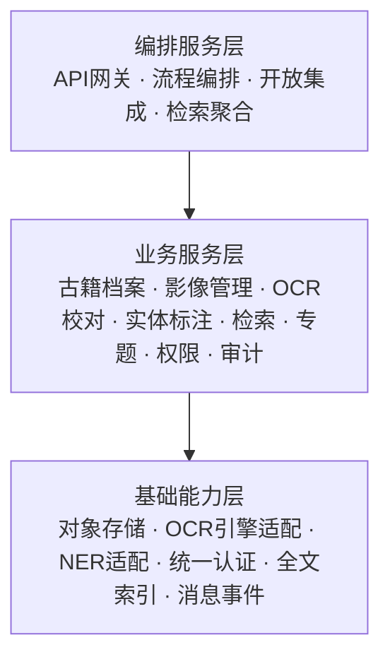
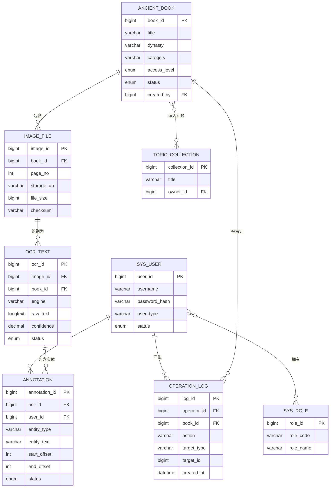

# 地方古籍文献数字化平台 —— 面向服务与数据层设计

> 题目背景：某高校数字人文研究中心拟搭建地方古籍文献数字化平台，支持古籍扫描件元数据著录、OCR 识别、人物地名实体标注、文献检索、专题汇编与成果共享，并需对接图书馆门户与学术成果系统。平台不要求一次性重构，需支持后续新增地方志、族谱等资源类型。

---

## 目录

- [一、问题 1：面向服务设计](#一问题-1面向服务设计)
  - [1.1 服务边界划分原则](#11-服务边界划分原则)
  - [1.2 核心服务清单](#12-核心服务清单)
  - [1.3 服务分层结构](#13-服务分层结构)
  - [1.4 接口契约示例（任选两个服务）](#14-接口契约示例任选两个服务)
  - [1.5 服务解耦手段与同步/异步选择](#15-服务解耦手段与同步异步选择)
- [二、问题 2：数据层概念与逻辑模型设计](#二问题-2数据层概念与逻辑模型设计)
  - [2.1 E-R 模型](#21-e-r-模型)
  - [2.2 核心数据表设计](#22-核心数据表设计)
  - [2.3 为什么影像文件不直接存入数据库](#23-为什么影像文件不直接存入数据库)
- [三、设计小结（评分要点对照）](#三设计小结评分要点对照)

---

## 一、问题 1：面向服务设计

### 1.1 服务边界划分原则

按 **"能力是否可复用 + 变化频率 + 数据归属"** 三个维度切分服务：

- **基础能力服务**：与具体古籍业务无关、可被多个服务乃至外部系统复用的技术能力（存储、OCR、NER、认证、索引、消息），本身不含业务规则。
- **业务服务**：承载古籍业务语义（档案、影像、校对、标注、检索、专题、权限、审计），只依赖基础能力服务的抽象接口。
- **编排服务**：负责跨服务流程串联、统一入口与对外集成，不持有领域数据本身。

这样切分后：替换 OCR 引擎只影响"OCR 引擎适配服务"；更换数据库只影响各服务自身的数据访问层，不会波及业务服务。

### 1.2 核心服务清单

| 层级 | 服务名称 | 核心职责 | 可复用点 |
| :--- | :--- | :--- | :--- |
| 基础能力 | **对象存储服务** | 影像大图/附件的分片上传、存储、签名 URL、缩略图 | 任何需要存文件的服务 |
| 基础能力 | **OCR 引擎适配服务** | 屏蔽具体引擎差异，输出文本行、坐标、置信度 | 可被其他系统复用 |
| 基础能力 | **NER 实体识别适配服务** | 人物/地名/朝代实体识别底座 | 标注服务与外部共用 |
| 基础能力 | **统一认证服务** | 登录、令牌签发与校验、身份上下文 | 所有服务共用一套身份 |
| 基础能力 | **全文检索索引服务** | 倒排索引构建与查询（ES/Lucene） | 元数据检索与全文检索共用 |
| 基础能力 | **消息事件服务** | 领域事件发布/订阅、削峰填谷 | 所有异步协作 |
| 业务 | **古籍档案服务** | 元数据著录、版本、资源类型、三级开放级别、审核状态 | — |
| 业务 | **影像管理服务** | 影像与卷页关系、调用存储服务、页序管理 | — |
| 业务 | **OCR 校对服务** | 校对工作流、人工修订与版本管理 | — |
| 业务 | **实体标注服务** | 标注、实体归一化、标注审核 | 复用 NER 底座 |
| 业务 | **检索服务** | 元数据 + 全文 + 实体组合检索，按权限过滤结果 | — |
| 业务 | **专题汇编服务** | 专题集、数据集导出、脱敏与水印 | — |
| 业务 | **权限管控服务** | 开放/校内/涉密三级策略判定与下发 | — |
| 业务 | **审计日志服务** | 记录"谁、何时、改了哪条记录" | — |
| 编排 | **API 网关** | 统一入口、鉴权、限流、路由、协议转换 | — |
| 编排 | **数字化流程编排服务** | 上传→OCR→校对→标注→审核→发布 的状态机驱动 | — |
| 编排 | **开放集成服务** | 对图书馆门户/成果系统提供 API、数据推送、配额管理 | — |

### 1.3 服务分层结构

```
┌──────────────────────────────────────────────────────────────┐
│ 编排服务层 │ API 网关 │ 流程编排 │ 开放集成 │ 检索聚合编排        │
├──────────────────────────────────────────────────────────────┤
│ 业务服务层 │ 古籍档案 │ 影像管理 │ OCR校对 │ 实体标注 │ 检索服务    │
│           │ 专题汇编 │ 权限管控 │ 审计日志                      │
├──────────────────────────────────────────────────────────────┤
│ 基础能力层 │ 对象存储 │ OCR引擎适配 │ NER引擎适配 │ 统一认证      │
│           │ 全文索引 │ 消息事件                               │
└──────────────────────────────────────────────────────────────┘
                    上层依赖下层，下层不感知上层业务语义
```

若 VS Code 安装了 *Markdown Preview Mermaid Support* 插件，下面的图也可直接渲染：



### 1.4 接口契约示例（任选两个服务）

#### 服务一：OCR 识别服务（基础能力服务，异步）

**服务职责**：接收影像引用，调用可插拔的 OCR 引擎，输出文本行、坐标与置信度；不感知古籍业务状态，识别完成后发布领域事件。

```json
// 入参 POST /ocr/tasks
{
  "request_id": "7f3a...",
  "image_id": "IMG-20260001-003",
  "storage_uri": "s3://ancient-books/IMG-20260001-003.tif",
  "engine": "paddleocr",
  "options": { "lang": "zh", "return_bbox": true },
  "callback": { "type": "mq", "topic": "ocr.completed" }
}
```

```json
// 出参：受理成功
{
  "code": 0,
  "message": "accepted",
  "data": { "task_id": "TASK-8812", "status": "QUEUED" }
}
```

```json
// 异步结果消息：发布到 ocr.completed
{
  "task_id": "TASK-8812",
  "image_id": "IMG-20260001-003",
  "status": "SUCCESS",
  "data": {
    "ocr_id": "OCR-5510",
    "full_text": "南通縣圖志卷一…",
    "lines": [
      { "text": "南通縣圖志", "bbox": [12, 30, 180, 52], "confidence": 0.97 }
    ]
  }
}
```

```json
// 异常返回
{
  "code": "OCR_ENGINE_UNAVAILABLE",
  "message": "engine timeout after 30s",
  "retryable": true,
  "data": null
}
// 其他异常码：INVALID_IMAGE_URI / UNSUPPORTED_ENGINE / QUOTA_EXCEEDED
```

#### 服务二：古籍档案服务（业务服务，同步）

**服务职责**：古籍元数据著录、版本管理、三级开放级别与审核状态维护，是元数据的唯一权威来源。

```json
// 入参 POST /api/v1/books
{
  "title": "南通县图志",
  "dynasty": "清",
  "author": "王城",
  "category": "LOCAL_GAZETTEER",
  "access_level": "CAMPUS",
  "metadata": { "edition": "光绪刻本", "volume_count": 24 },
  "operator_id": "U-1001"
}
```

```json
// 出参
{
  "code": 0,
  "message": "ok",
  "data": {
    "book_id": "B-20260001",
    "version": 1,
    "status": "DRAFT",
    "created_at": "2026-11-20T17:25:33+08:00"
  }
}
```

```json
// 异常返回
{
  "code": "FORBIDDEN",
  "message": "user cannot set RESTRICTED level",
  "fields": ["access_level"],
  "data": null
}
// 其他异常码：VALIDATION_FAILED / DUPLICATE_TITLE / OPTIMISTIC_LOCK_CONFLICT
```

### 1.5 服务解耦手段与同步/异步选择

**解耦手段**

1. **数据库私有**：每个服务独占自己的库/表，其他服务只能通过 API 访问，禁止跨库 JOIN。
2. **接口契约化**：REST/gRPC + OpenAPI/JSON Schema 定义入出参，接口版本化并保持向后兼容。
3. **网关隔离**：外部只见到网关，内部服务拓扑变化对调用方透明。
4. **适配器 + 配置中心**：OCR/NER 引擎通过统一接口接入，换引擎只改配置与适配器实现。
5. **事件驱动**：`BookCreated`、`OcrCompleted`、`AnnotationApproved` 等领域事件经 MQ 广播，上下游不互相持有引用。
6. **认证集中**：认证服务签发令牌，业务服务只校验令牌，不自建用户体系。

**同步调用场景**：元数据查询、用户登录/鉴权、权限判定、简单检索、单条记录读取。
理由：要求低延迟、结果立即使用、强一致性；调用链短，失败可直接返回给前端。

**异步调用场景**：OCR 识别、影像批量预处理、批量标注、全文索引重建、数据导出、向图书馆门户推送数据。
理由：耗时且可延迟；用 MQ 可削峰填谷、隔离故障、实现最终一致，避免长事务阻塞用户请求。

> 判断标准：**"用户此刻必须拿到结果"用同步；"后台慢慢做、做完通知我"用异步。**

---

## 二、问题 2：数据层概念与逻辑模型设计

### 2.1 E-R 模型

#### 实体清单

| 实体 | 主键 | 主要属性 | 外键 |
| :--- | :--- | :--- | :--- |
| 古籍 ANCIENT_BOOK | book_id | 题名、朝代、作者、资源类型、开放级别、状态、扩展元数据 | created_by → 用户 |
| 影像 IMAGE_FILE | image_id | 卷页号、存储 URI、文件大小、格式、校验和 | book_id → 古籍 |
| OCR 文本 OCR_TEXT | ocr_id | 引擎、原始文本、行级 JSON、置信度、校对状态 | image_id → 影像；book_id → 古籍 |
| 标注 ANNOTATION | annotation_id | 实体类型、实体文本、offsets、归一化名、审核状态 | ocr_id → OCR；user_id → 用户 |
| 用户 SYS_USER | user_id | 用户名、口令哈希、姓名、用户类型、状态 | — |
| 角色 SYS_ROLE | role_id | 角色编码、角色名 | — |
| 用户角色 SYS_USER_ROLE | (user_id, role_id) | 关联关系 | 双 FK |
| 操作日志 OPERATION_LOG | log_id | 操作人、动作、目标类型、目标 ID、前后快照、时间 | operator_id → 用户；book_id → 古籍 |
| 专题 TOPIC_COLLECTION | collection_id | 专题名、说明、创建人 | owner_id → 用户 |

#### 实体间关系

- 古籍 **1 : N** 影像（一部古籍含多卷页影像）
- 影像 **1 : N** OCR 文本（同一页可多引擎/多次识别，保留版本）
- OCR 文本 **1 : N** 标注（一段文本可标多个实体）
- 用户 **1 : N** 标注；用户 **N : M** 角色
- 用户 **1 : N** 操作日志；日志 **N : 1** 古籍（审计某条记录）
- 古籍 **N : M** 专题（通过 `book_collection` 关联表）

#### E-R 图

文字化关系示意（任何编辑器均可查看）：

```
SYS_USER ──N:M── SYS_ROLE
   │ 1:N
   ├────1:N──── OPERATION_LOG ──N:1── ANCIENT_BOOK
   └────1:N──── ANNOTATION ──N:1── OCR_TEXT ──N:1── IMAGE_FILE ──N:1── ANCIENT_BOOK
                                                     
ANCIENT_BOOK ──N:M── TOPIC_COLLECTION
```

Mermaid 版（需 VS Code 安装 Mermaid 预览插件）：



### 2.2 核心数据表设计

#### ① 古籍主表 `ancient_book`

| 字段 | 类型 | 约束 / 索引 | 说明 |
| :--- | :--- | :--- | :--- |
| book_id | BIGINT | PK, AUTO_INCREMENT | 古籍唯一标识 |
| title | VARCHAR(200) | NOT NULL, IDX_title | 题名 |
| dynasty / author | VARCHAR(50/100) | — | 朝代、作者 |
| category | VARCHAR(50) | NOT NULL, IDX_category | 资源类型（地方志 / 族谱…），便于扩展 |
| access_level | ENUM('OPEN','CAMPUS','RESTRICTED') | NOT NULL, IDX_level | 开放 / 校内 / 涉密三级隔离 |
| status | ENUM('DRAFT','PENDING_REVIEW','PUBLISHED','ARCHIVED') | NOT NULL, IDX_status | 著录→审核→发布状态 |
| metadata_json | JSON | — | 扩展字段，新增资源类型不改表结构 |
| created_by | BIGINT | NOT NULL, FK → sys_user | 著录人 |
| created_at / updated_at | DATETIME | NOT NULL | 时间戳 |
| version | INT | NOT NULL DEFAULT 1 | 乐观锁，防并发覆盖 |

**索引**：`PRIMARY(book_id)`、`IDX_title(title)`、`IDX_category`、`IDX_level`、`IDX_status`、`IDX_created_at`、`FULLTEXT(title, author, description)`。

#### ② 影像文件表 `image_file`

| 字段 | 类型 | 约束 / 索引 | 说明 |
| :--- | :--- | :--- | :--- |
| image_id | BIGINT | PK | 影像唯一标识 |
| book_id | BIGINT | NOT NULL, FK, IDX_book | 所属古籍 |
| page_no | INT | NOT NULL, UNIQUE(book_id, page_no) | 卷页序号 |
| file_name | VARCHAR(255) | NOT NULL | 原始文件名 |
| **storage_uri** | VARCHAR(500) | NOT NULL | 对象存储地址，**非文件本体** |
| file_size / width / height | BIGINT / INT / INT | — | 影像元数据 |
| format / checksum | VARCHAR(20) / VARCHAR(64) | — | 格式与完整性校验 |
| uploaded_by / uploaded_at | BIGINT / DATETIME | NOT NULL | 上传留痕 |

**索引**：`PRIMARY(image_id)`、`UNIQUE(book_id, page_no)`、`IDX_book(book_id)`。

#### ③ OCR 文本表 `ocr_text`

| 字段 | 类型 | 约束 / 索引 | 说明 |
| :--- | :--- | :--- | :--- |
| ocr_id | BIGINT | PK | 文本版本唯一标识 |
| image_id | BIGINT | NOT NULL, FK | 来源影像 |
| book_id | BIGINT | NOT NULL, FK, IDX_book | 受控冗余，避免按古籍检索时多表 JOIN |
| engine | VARCHAR(50) | NOT NULL | 记录所用引擎，便于替换与效果对比 |
| raw_text | LONGTEXT | NOT NULL, FULLTEXT | 原始识别文本 |
| line_json | JSON | — | 行级文本、坐标、置信度 |
| confidence | DECIMAL(5,2) | — | 整体置信度 |
| status | ENUM('RAW','PROOFREADING','PROOFREAD') | NOT NULL, IDX_status | 校对工作流状态 |
| proofread_by | BIGINT | FK | 校对人 |
| version | INT | NOT NULL | 多版本保留 |

**索引**：`PRIMARY(ocr_id)`、`UNIQUE(image_id, engine, version)`、`IDX_book`、`IDX_status`、`FULLTEXT(raw_text)`。

#### ④ 标注记录表 `annotation`

| 字段 | 类型 | 约束 / 索引 | 说明 |
| :--- | :--- | :--- | :--- |
| annotation_id | BIGINT | PK | 标注唯一标识 |
| ocr_id / book_id / user_id | BIGINT | NOT NULL, FK, 各自 IDX | 来源文本、古籍、标注人 |
| entity_type | ENUM('PERSON','PLACE','DYNASTY','OTHER') | NOT NULL, IDX_type | 实体类型 |
| entity_text | VARCHAR(200) | NOT NULL, IDX_text(50) | 标注原文 |
| standard_name | VARCHAR(200) | — | 归一化实体名 |
| start_offset / end_offset | INT | NOT NULL | 在 raw_text 中的位置 |
| confidence | DECIMAL(5,2) | — | AI 预标注置信度 |
| status | ENUM('DRAFT','SUBMITTED','APPROVED','REJECTED') | NOT NULL, IDX_status | 审核状态 |
| reviewed_by / reviewed_at | BIGINT / DATETIME | — | 审核留痕 |
| created_at / updated_at | DATETIME | NOT NULL | 时间戳 |

#### ⑤ 用户权限表（规范化为三张）

- **sys_user**：`user_id` PK、`username` UNIQUE NOT NULL、`password_hash` NOT NULL、`real_name`、`user_type` ENUM('ADMIN','ARCHIVIST','RESEARCHER','GUEST') NOT NULL、`status` NOT NULL、`created_at`。
- **sys_role**：`role_id` PK、`role_code` UNIQUE NOT NULL、`role_name` NOT NULL。
- **sys_user_role**：`user_id` + `role_id` 联合 PK，两个 FK，实现 N:M 关系。

#### ⑥ 操作日志表 `operation_log`（只追加，不 UPDATE / DELETE）

| 字段 | 类型 | 约束 / 索引 | 说明 |
| :--- | :--- | :--- | :--- |
| log_id | BIGINT | PK | 日志唯一标识 |
| operator_id | BIGINT | NOT NULL, FK, IDX_operator | **谁** |
| operator_name | VARCHAR(50) | NOT NULL | 姓名快照，防改名后无法追溯 |
| action | VARCHAR(50) | NOT NULL, IDX_action | 做了什么（CREATE / UPDATE / REVIEW / EXPORT…） |
| target_type / target_id | VARCHAR(50) / BIGINT | NOT NULL, IDX_target | **改了哪条记录**（多态关联） |
| book_id | BIGINT | IDX_book | 受控冗余，便于按古籍审计 |
| before_data / after_data | JSON | — | 变更前后快照 |
| detail / ip | VARCHAR(500) / VARCHAR(50) | — | 补充说明 |
| created_at | DATETIME | NOT NULL, IDX_created | **何时** |

**附属表**：`book_collection(book_id, collection_id)` 联合主键 + 双 FK，支撑古籍与专题的 N:M；`role_permission(role_id, resource, action)` 支撑细粒度授权。

**范式说明**：影像、OCR、标注各自独立成表，避免把大文本和多值属性塞进古籍主表；`metadata_json` 只放稀疏扩展属性；`book_id` 在 OCR / 标注 / 日志中的有限冗余纯粹为检索性能，属于受控反范式。三级权限由 `access_level` 字段 + 服务层行级过滤 + 对象存储带时效签名 URL 共同保证，涉密文献的 URL 永不下发匿名访客。

### 2.3 为什么影像文件不直接存入数据库

1. **体积膨胀**：扫描件多为几百 MB 的 TIFF / JPG，以 BLOB 入库会让库文件急剧变大，备份、恢复、主从同步的成本和失败率都大幅上升。
2. **查询性能**：数据库缓冲池会被大对象占满，挤占热数据缓存；检索元数据时不得不扫描大字段，I/O 被放大。
3. **访问模式不匹配**：影像需要 Range 请求、断点续传、CDN 边缘分发、缩略图按需生成，这些是对象存储的强项，关系库不擅长。
4. **事务与并发**：大文件写入会拉长事务、延长行锁时间，阻塞元数据更新。
5. **可扩展性**：对象存储可水平扩展到 PB 级且成本更低；影像与结构化数据的增长曲线不同，不宜捆绑。
6. **解耦要求**：业务约束明确"未来可替换数据库、可替换存储后端"。库里只存 `storage_uri`，底层从 MinIO 换成 S3 / OSS 时，只改对象存储服务，业务表和 SQL 都不用动。

因此采用 **"结构化元数据入关系库 + 影像入对象存储 + 表中只存 URI 指针"** 的分离方案，既符合业务约束，也便于权限隔离和审计。

---